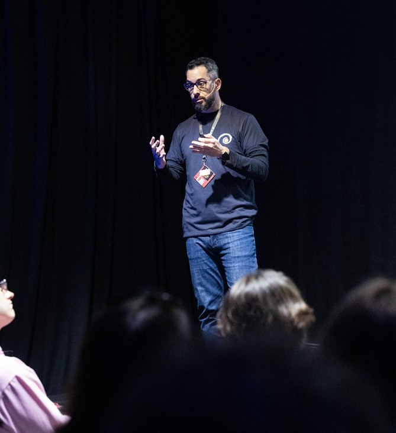

---
# the default layout is 'page'
icon: fas fa-info-circle
order: 6
title: "Sobre mí"
lang: es
---

<!-- >> Add Markdown syntax content to file `_tabs/about.md`{: .filepath } and it will show up on this page.
{: .prompt-tip } -->

> 🇬🇧 [Read this page in English](/about-en/)

  
  

    

      <strong>Transformo los desafíos técnicos</strong> de la seguridad informática y los sistemas Unix <strong>en soluciones comprensibles y aplicables</strong>.
        
      Promuevo una infraestructura open source accesible, confiable y guiada por la ética y la comunidad.
    

  

  Soy <strong>Pablo González</strong>, <strong>Sultanovich</strong> en la comunidad.
   
   Soy <em>Security Architect</em>, actualmente en Wazuh,
    donde combino mi experiencia en seguridad informática con mi pasión por los sistemas Unix y el software libre.

  Trabajo con sistemas Unix y seguridad informática hace más de 20 años.  
  Comencé administrando servidores y hoy diseño y fortalezco infraestructuras en la nube,  
  priorizando siempre soluciones basadas en <strong>open source</strong>.

  A lo largo de mi carrera encontré en el software libre no solo herramientas,  
  sino una forma de entender la tecnología: <strong>colaborativa, transparente y ética</strong>.

  Creo que la seguridad no se trata solo de controles, sino de <strong>valores y responsabilidad profesional</strong>.  
   
  Por eso busco fomentar una cultura técnica más abierta y guiada por principios,  
  donde el conocimiento se comparte y las soluciones se construyen colectivamente.

  En este blog encontrarás artículos sobre <strong>arquitectura de seguridad</strong>, <strong>plataformas cloud seguras</strong>,  
  <strong>IAM y automatización</strong>, <strong>cumplimiento (PCI DSS, SOC 2)</strong> y herramientas libres como <strong>Debian</strong>,  
  <strong>Wazuh</strong> y <strong>Kubernetes</strong>.  
   
  También comparto notas sobre mi crecimiento profesional y las decisiones que acompañan ese camino.

  Mi objetivo es seguir aprendiendo, compartir lo que sé y aportar a la comunidad <strong>open source</strong>.  
   
  Sigo construyendo ese camino con la meta de contribuir como  <strong>mentor y referente en seguridad open source en Latinoamérica</strong>.

  Me interesa la <strong>ciencia ficción</strong> (Asimov, Tolkien) y los <strong>proyectos makers</strong>;  
  suelo experimentar con <strong>Raspberry Pi</strong> (o distintos SBC) y entornos de <strong>self-hosting</strong>.

  ☕ <strong>Gracias por visitar mi blog</strong>  
  Espero que encuentres aquí algo que te ayude, te inspire o simplemente te motive  
  a seguir construyendo tecnologías libres.

