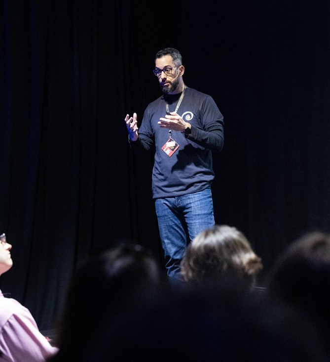

---
# the default layout is 'page'
icon: fas fa-info-circle
title: "About Me"
lang: en
layout: page
sitemap: true
permalink: /about-en/
---

> 🇪🇸 [Leer esta página en español](/about/)

  
  

    

      <strong>I turn the technical challenges</strong> of information security and Unix systems <strong>into clear and applicable solutions</strong>.
        
      I promote an open source infrastructure that is accessible, reliable, and guided by ethics and community.
    

  

  I'm <strong>Pablo González</strong>, known in the community as <strong>Sultanovich</strong>.
   
  I'm a <em>Security Architect</em>, currently at Wazuh, where I combine my experience in information security with my passion for Unix systems and free software.

  I've been working with Unix systems and information security for more than 20 years.  
  I started as a server administrator and today I design and strengthen cloud infrastructures,  
  always prioritizing solutions based on <strong>open source</strong>.

  Throughout my career, I’ve found in free software not just tools,  
  but a way to understand technology: <strong>collaborative, transparent, and ethical</strong>.

  I believe security is not only about controls, but about <strong>principles and professional responsibility</strong>.  
   
  That’s why I seek to promote a technical culture that is more open and guided by integrity,  
  where knowledge is shared and solutions are built collectively.

  In this blog, you'll find articles on <strong>security architecture</strong>, <strong>secure cloud platforms</strong>,  
  <strong>IAM and automation</strong>, <strong>compliance (PCI DSS, SOC 2)</strong>, and open source tools such as <strong>Debian</strong>,  
  <strong>Wazuh</strong>, and <strong>Kubernetes</strong>.  
   
  I also share reflections on my professional growth and the decisions that shape that path.

  My goal is to keep learning, share what I know, and contribute to the <strong>open source</strong> community.  
   
  I continue building this path with the aim of contributing as a <strong>mentor and open source security advocate in Latin America</strong>.

  I'm passionate about <strong>science fiction</strong> (Asimov, Tolkien) and <strong>maker projects</strong>;  
  I often experiment with <strong>Raspberry Pi</strong> (and other SBCs) and <strong>self-hosting environments</strong>.

  ☕ <strong>Thanks for visiting my blog</strong>    
  I hope you find something here that helps you, inspires you,  
  or simply motivates you to keep building open and secure technology.

